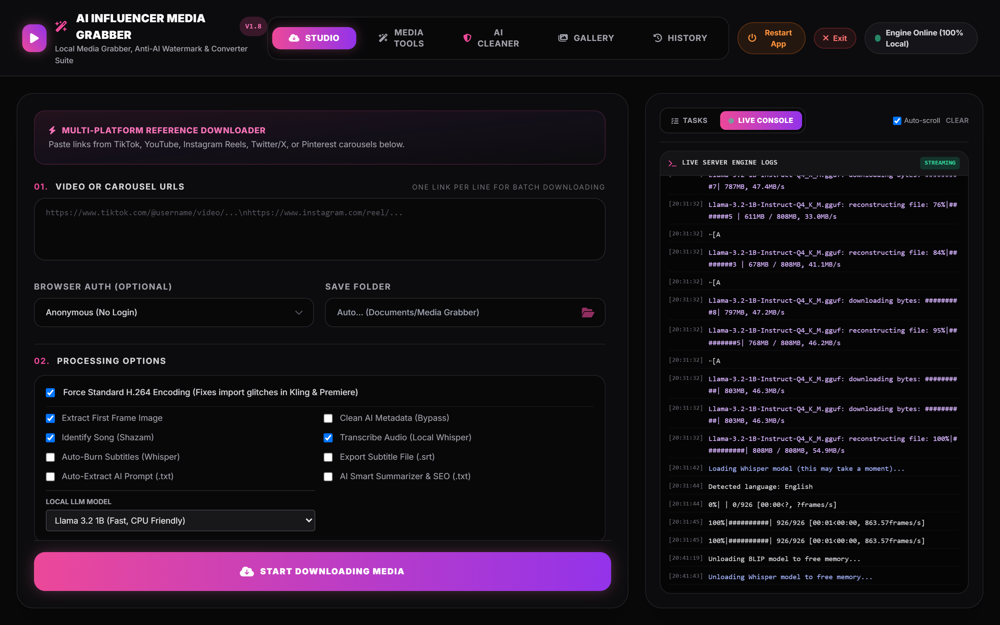
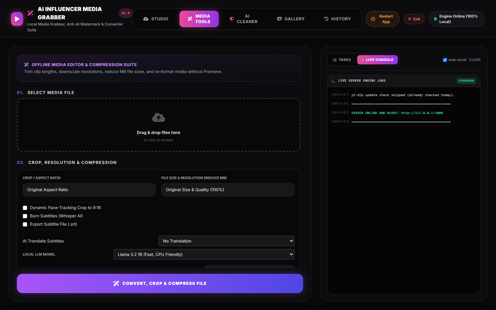
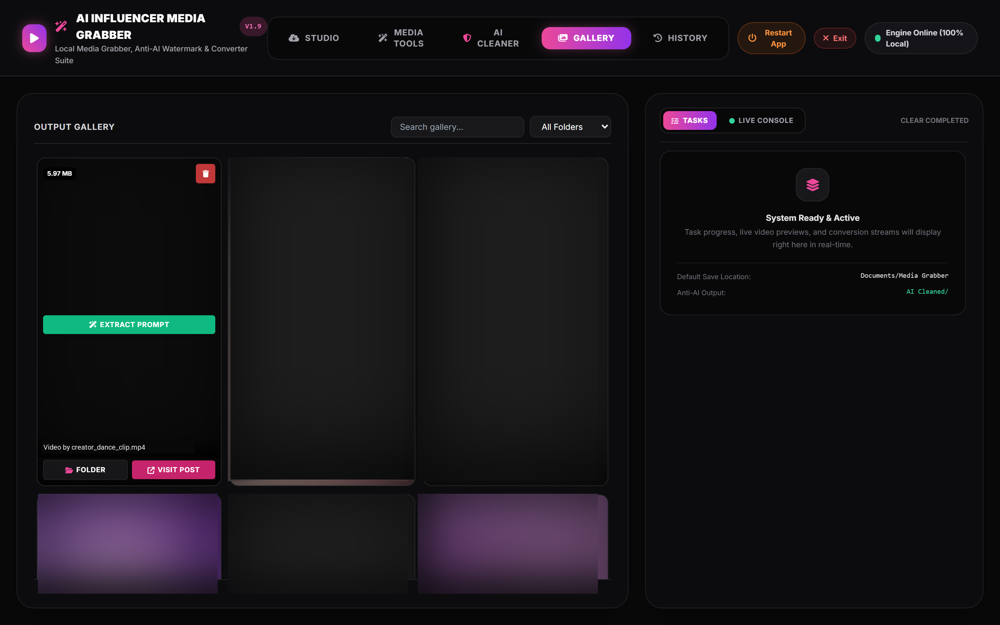
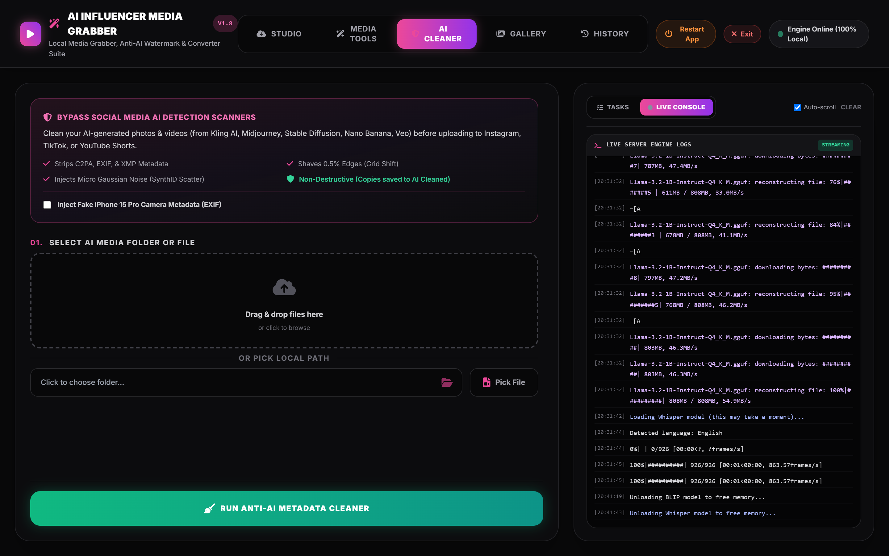
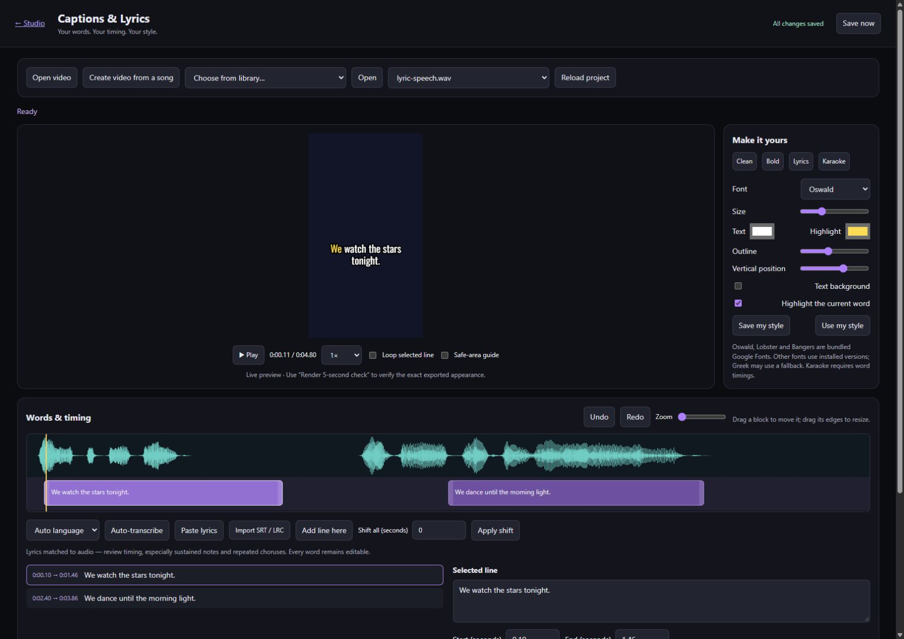

# AI Influencer Media Grabber

**A Windows desktop toolkit for downloading reference media, editing videos and photos, and creating captioned content for Reels, TikTok and YouTube Shorts.**

Save a reference clip, extract its first frame, prepare a character replacement for Nano Banana and Kling, or work on your own footage. The app brings downloading, conversion, a media library, and editable captions into one place.

[Download the latest Windows release](https://github.com/NextGenInfluencer/ai-influencer-media-grabber/releases/latest) · [Release notes](RELEASE_NOTES.md) · [Implementation details](IMPLEMENTATION_NOTES.md)

## A look inside

  
  
   
  
  

*Studio screenshots show the earlier interface; available controls can differ by version.*

## What you can do

### Download reference media

- Download videos from TikTok, YouTube and YouTube Shorts, Instagram Reels, and other sites supported by the download engines.
- Save Instagram photos and carousel media, with a gallery-dl fallback where applicable.
- Choose the best available source quality, including higher-resolution YouTube streams when available. The source platform determines the maximum quality.
- Extract audio to MP3, or save the first video frame as an image.
- Optionally convert to standard H.264 for import compatibility. This re-encodes the video; it does not improve character recognition or recover missing detail.
- Keep source-post links alongside your downloads and revisit posts from the gallery.

TikTok downloads use the available source stream, which can avoid the additional watermark on TikTok's normal downloaded copy. Watermarks already embedded in the source cannot simply be removed. Private, restricted or changed platform endpoints may require cookies or may not be available.

### Edit your own videos and pictures

Use **Media Tools** for conversion, trimming, crop/resize, vertical framing, blurred padding, GIF creation, audio extraction and frame sequences. Output choices include common sharing formats and higher-quality editing formats. Face-tracking framing options help turn suitable footage into vertical clips.

The **Output Gallery** keeps downloaded and generated media together, with previews, file actions and prompt extraction. Local uploads can be used without downloading anything first.

### Prepare Nano Banana → Kling references

Extract a first frame, replace the person with your influencer in your image tool, then use the matching reference video in Kling. The prompt helper describes the scene while instructing the image tool to preserve pose, framing, clothing and lighting. **Kling Prep** helps prepare compatible, matching video/frame outputs; it does not run Kling or guarantee generation quality.

### Captions & Lyrics

Open **Captions & Lyrics** from the Studio navigation:

1. Upload a video or choose one from the media library.
2. Auto-transcribe with the optional AI Pack, paste lyrics, or import SRT/LRC.
3. Edit the words and timing on the waveform timeline. Move or resize caption blocks, split/merge lines, loop a line, adjust playback speed, and undo edits.
4. Choose a font, colours, size, outline, position, background and word-by-word highlighting. Watch changes in the live preview.
5. Use **Render 5-second check** to see actual export typography, then export a captioned H.264 MP4 or an SRT file.

Projects autosave under `Caption Projects` in your media library. SRT carries text and timing, not fonts or effects. Automatic transcription needs review, especially for songs. Browser text layout is an approximation; the rendered check shows the final result.

### Karaoke from your existing SRT

Import your SRT and click **Add karaoke timing to all subtitles**. This analyses each line's audio and adds word timings while keeping your text, line breaks, line start/end times and style. Enable **Highlight the current word** to see the result.

The alignment-language selector supports English, French, Korean, Greek, Spanish, German, Italian, Portuguese, Japanese, Chinese, Arabic, Hindi, Russian and Turkish. Choose **Detect per line**, **English + French**, **Korean + English** or **English + French + Korean** for mixed songs, or override a single language and **Retry karaoke for this line**. Ambiguous scripts use local audio language detection; short sung lines can be misidentified. Korean highlighting follows space-separated words. For untimed pasted mixed lyrics, sync matching language sections; these mixed modes apply to the existing-subtitle karaoke action. Mixed-language and unusually short timings are flagged. **Next line to review** visits missing or flagged timings; listen, edit the word boundaries and mark them reviewed. Flags are timing heuristics, not guaranteed accuracy scores.

Failed lines retain their earlier words/timings. **Estimate missing timings** is an explicit approximate fallback, labelled for review. A cancelled operation preserves saved captions; **Restore previous karaoke version** restores the captions from before the last completed karaoke operation, including after reopening the project. Undo also works in the editing session. Long individual lines over 60 seconds need splitting before alignment.

### New in the source checkout (not yet in the v2.5.0 installer)

- **Sync pasted lyrics to audio:** keeps your supplied text and line breaks, with editable word timings. Choose the language and the section of audio containing those lyrics. Standalone Suno labels such as `[Verse]` are ignored; repeated sung lines must still be included. Uses local Whisper with stable-ts. Singing and repeated choruses can need corrections. If individual words have invalid timing, usable timings are retained and uncertain gaps are estimated and flagged for review. Too few reliable timing anchors still stops the operation. The prior captions are retained as a restore point.
- **Create video from a song:** start with MP3, WAV, M4A, FLAC or OGG. Choose portrait, square or landscape; use a colour, uploaded photo/video or a library background. Short video backgrounds loop and fill the frame with a centre crop. The song replaces background audio.
- **Audio-reactive waveform:** optionally add a waveform along the bottom of the song video. Use **Background & audio → Edit composition** to change or remove it later; the original song and background remain available.
- **Bundled fonts:** Oswald, Lobster and Bangers from Google Fonts, with their open-font licenses, work locally in preview and export. Glyph coverage varies; Greek and Korean may use installed fallback fonts.
- **Background discovery links:** open Pexels or Pixabay, download a suitable asset, then import it. There is no integrated stock search or automatic asset import yet.

Song creation and lyric alignment support up to 20 minutes per operation. Use only the lyrics for the selected audio section. Existing captions are preserved if alignment fails or is cancelled. Manual estimates remain available without AI.

### Editable background and audio composition (source)

Open a song/video project and select **Background & audio → Edit composition**. Replace a background from an upload or your library without losing captions, word timings or style. Choose portrait/square/landscape, fit or fill, horizontal/vertical focus, blur, dimming, tint and slow zoom. Video backgrounds can loop or hold their final frame; still images last for the composition.

Trim the song, delay its start, adjust volume and fades, and optionally mix the background video's audio (muted by default). Lyrics follow changes to the song's source trim/delay. Lines outside the range are removed from that version; cut lines keep their text but lose word timings and are flagged for review. Replacing a song preserves captions and flags them so you can check synchronization.

**Apply & preview** renders a synchronized base and preview using the same composition specification. Seeking, playback speed and lyric looping then use that single prepared timeline. This step is not an instant multitrack preview; caption styling remains live. Use **Restore previous composition** to recover the prior composition and captions, or **Duplicate project** before exploring alternatives.

Projects retain original assets and a versioned composition schema (assets, tracks, clips, source offsets, transforms and text style). Legacy projects remain readable and receive a pre-migration JSON backup when first saved. Missing media is reported; upload its original file in the composition dialog to relink it. Captions autosave; **Recover unsaved captions** offers this browser's saved draft after an interrupted edit. Composition settings have a local draft too; file selections must be chosen again after restart. Generated versions are retained, so repeated changes require additional disk space.

### Optional AI tools and metadata cleanup

The AI Pack enables Whisper transcription, BLIP image descriptions and optional local language-model features. Model files require additional downloads and storage. Music identification uses an online service.

Metadata tools can clean embedded tags and create processed copies. They do **not** guarantee removal of visible/invisible watermarks or prevention of AI detection.

## Install and launch

### Windows installer

1. Open [Releases](https://github.com/NextGenInfluencer/ai-influencer-media-grabber/releases).
2. Download the latest `Setup.exe`, run it, and launch the desktop shortcut.
3. Enable the optional AI Pack when you need transcription or image analysis.

The installer bundles the core runtime. You do not need a separate Python installation for that copy. Your media library normally lives in `Documents/Media Grabber`.

### Run from source

Use Python 3.13 and Node 26 for the supported build/test configuration. Install `requirements.txt`, then run `app_local.py`, or use `run.bat` on Windows. `create_shortcut.bat` creates a shortcut; `launch-silent.vbs` opens the app from the folder containing that launcher.

For AI features, install `requirements-ai.txt` into the **same environment** used by the launcher. Existing AI installations need the updated pack for automatic lyric alignment. Restart after installing it.

**A source shortcut and an installed desktop shortcut can point at different app copies.** After updating files, fully exit the running app and reopen the matching shortcut. The launcher reuses an already-running local server.

## Updates

The in-app GitHub updater checks published releases and validates staged changes before applying them. Updates that change dependencies require the release installer. In particular, use the v2.5.0 installer when upgrading an older installed copy to the first Captions & Lyrics release. New source features listed above are not available through the published v2.5.0 installer yet.

| Version | Highlights |
| --- | --- |
| Source changes | Multilingual batch karaoke, editable background/audio composition, project duplication/recovery, supplied-lyric alignment, waveform visualizer and bundled fonts |
| v2.5.0 | Captions & Lyrics editor, waveform timeline, live styling, karaoke and rendered exports |
| v2.4.1 | Improved Nano Banana character-replacement prompt |
| v2.4.0 | Kling reference workflow and reliability/security fixes |
| v2.3 | Higher-quality output formats and trimming improvements |
| v2.2 | Higher-resolution downloads and expanded framing options |
| v2.1 | In-app release checking and updating |
| v2.0 | Windows installer, silent desktop launcher and optional AI Pack |

See [full release notes](RELEASE_NOTES.md) for current releases and [GitHub release history](https://github.com/NextGenInfluencer/ai-influencer-media-grabber/releases) for earlier downloads.

## Development

Run `python -m unittest discover -s tests -v`, `node tests/test_stream.js` and `node --check static/captions.js`. Build staging with `python build_staging.py`; Inno Setup 6 produces the Windows installer. Cached runtime downloads are checked against pinned SHA-256 values.

See [caption implementation and next steps](CAPTIONS_PLAN.md). This is a focused creator toolkit: a full multitrack editor, integrated stock search, editable motion templates and advanced text animation remain future work.

Media processing runs locally. Downloads, model acquisition, release checks and music recognition use online services. Use media you own or have permission to reuse and check stock-asset licensing before publishing.
